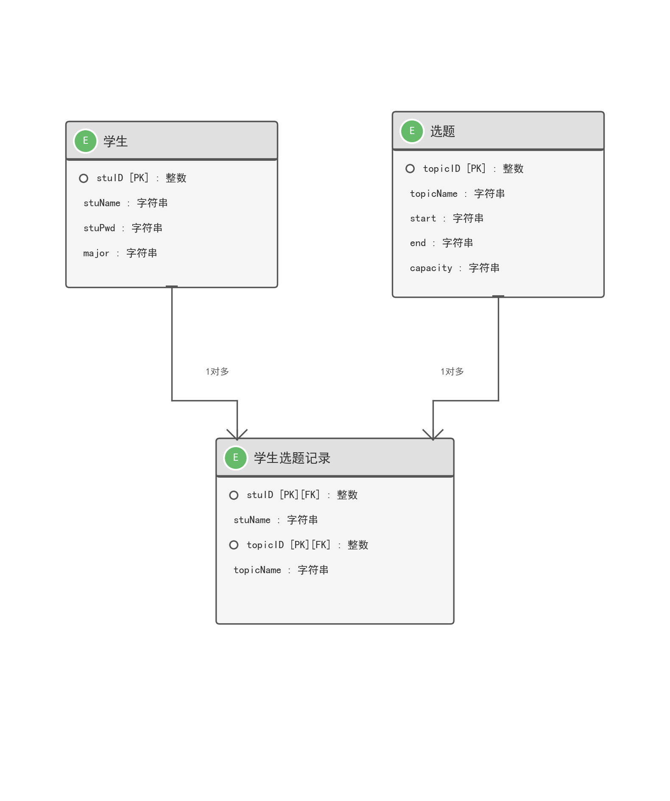

# JAVA EE 框架课程设计

# 课程设计报告

---

**项目名称：** 毕业设计选题管理系统

**学　　号：** ________________

**姓　　名：** ________________

**专　　业：** ________________

**指导教师：** ________________

**2026 年 7 月**

---

## 目录

- [一、设计目的](#一设计目的)
  - [1.2 设计要求](#12-设计要求)
- [二、项目概述](#二项目概述)
- [三、需求分析](#三需求分析)
  - [3.1 功能需求](#31-功能需求)
  - [3.3 非功能需求分析](#33-非功能需求分析)
- [四、系统设计](#四系统设计)
  - [4.1 系统架构设计](#41-系统架构设计)
  - [4.2 功能模块设计](#42-功能模块设计)
  - [4.3 数据库设计](#43-数据库设计)
  - [4.4 界面设计](#44-界面设计)
- [五、系统实现](#五系统实现)
  - [5.1 功能模块划分](#51-功能模块划分)
  - [5.2 核心模块详细设计](#52-核心模块详细设计)
    - [5.2.1 用户管理模块](#521-用户管理模块)
    - [5.2.2 学生管理模块](#522-学生管理模块)
    - [5.2.3 选题管理模块](#523-选题管理模块)
    - [5.2.4 学生选题模块](#524-学生选题模块)
  - [5.3 开发环境](#53-开发环境)
  - [5.4 关键技术](#54-关键技术)
  - [5.5 核心代码](#55-核心代码)
- [六、系统测试与运行](#六系统测试与运行)
  - [6.1 测试用例](#61-测试用例)
  - [6.2 问题及解决方法](#62-问题及解决方法)
- [七、总结与展望](#七总结与展望)
  - [7.1 小结](#71-小结)
  - [7.2 展望](#72-展望)
- [参考文献](#参考文献)

---

## 一、设计目的

随着高校信息化建设的不断推进，毕业设计作为本科教学的重要环节，其选题管理工作逐渐从传统的纸质方式向数字化方向转变。传统的毕业设计选题过程中，学生与教师之间的信息沟通主要依赖线下表格或口头传达，存在选题信息不透明、选题冲突难以协调、统计效率低下等问题。特别是在学生人数较多、选题方向复杂的情况下，人工管理选题的方式不仅耗费大量时间，还容易出现数据遗漏、重复选题等管理失误。

基于此背景，本课程设计旨在开发一套基于 Java EE 技术栈的"毕业设计选题管理系统"，通过信息化手段实现选题管理的自动化与规范化。系统采用 B/S 架构，学生可通过浏览器直接浏览所有可选题目，并根据个人兴趣进行在线选题；管理员可对学生和选题信息进行统一管理，实时掌握选题情况。

本项目的核心设计目的包括以下三个方面：

（1）**业务层面**：建立一套完整的毕业设计选题信息管理平台，实现学生信息管理、选题信息发布、学生在线选题、选题记录查询等核心功能，解决传统人工选题模式中存在的信息不对称、统计困难、重复选题等问题。

（2）**技术层面**：通过本次课程设计，深入掌握 Spring MVC 框架的请求处理流程与 MVC 设计模式，学习 MyBatis 持久层框架的 SQL 映射与动态查询技术，理解 Maven 项目构建工具在多模块项目中的依赖管理方法，巩固 Java Web 开发的核心技能。

（3）**实践层面**：将课堂所学的 Java EE 框架知识（Spring MVC、MyBatis、Spring 整合）应用到实际项目开发中，体验从需求分析、系统设计、编码实现到测试部署的完整软件开发生命周期，提升工程实践能力。

### 1.2 设计要求

本系统设计要求如下：功能需求满足课程设计基本要求，涵盖学生信息管理、选题管理、学生在线选题、选题记录查询等核心模块；界面设计应简洁美观、布局合理，具备良好的用户体验；数据库设计应规范，表结构清晰，支持数据完整性与一致性；采用 B/S 架构，基于 Web 应用开发；使用 Java EE 技术栈（Spring MVC、MyBatis、JSP、MySQL 等）；系统应具备可扩展性，方便后续功能扩充。

---

## 二、项目概述

本系统为"毕业设计选题管理系统"，基于 Java EE 技术栈（Spring MVC + MyBatis + MySQL）开发，采用 B/S 架构。系统实现了学生信息管理、毕业设计选题管理、学生选题记录查询等核心功能。

系统采用 Maven 构建工具，前端使用 JSP + Bootstrap 技术，后端采用 Spring MVC 框架进行控制层处理，MyBatis 作为数据持久层框架，MySQL 作为关系型数据库。系统支持分页查询、数据增删改查、学生选题等常见业务操作。

## 三、需求分析

### 3.1 功能需求

#### 3.1.1 系统用例图

系统用例图如下所示，主要包含两类用户：管理员（教师）和学生。

#### 3.1.2 系统 ER 图

系统 ER 图如下所示，包含学生、选题、学生选题记录三个实体。

#### 3.1.3 功能需求分析

系统主要面向两类用户：系统管理员（教师）和学生。管理员可对学生信息、选题信息进行增删改查管理；学生可浏览选题列表并选择自己感兴趣的毕业设计题目。具体功能需求如下：

| 角色 | 功能需求 |
|------|---------|
| **学生** | 1. 登录系统：学生输入学号和密码（姓名）进行登录验证，登录成功后进入系统首页； 2. 浏览选题：学生可查看所有可选的毕业设计选题，了解选题名称、时间、容量等信息； 3. 选择选题：学生登录后可选择感兴趣的选题，系统校验选题容量与重复选题限制； 4. 查看我的选题：学生可查看自己已经选择的选题记录； 5. 退出登录：学生退出系统，清除 Session 会话。 |
| **管理员（教师）** | 1. 登录系统：管理员输入账号密码进行登录验证； 2. 学生管理：对学生信息进行增删改查操作，包括学号、姓名、密码、专业等字段； 3. 选题管理：对毕业设计选题进行增删改查操作，包括选题名称、开始时间、结束时间、容量等字段； 4. 查看选题记录：查询所有学生的选题情况，了解各选题的已选人数； 5. 退出登录：管理员退出系统，清除 Session 会话。 |

### 3.2 系统模块划分

| 系统名称 | 系统类/模块 | 功能说明 | 用户 |
|---------|-----------|---------|------|
| 毕业设计选题管理系统 | 学生管理模块 | 学生信息的增删改查、分页展示 | 管理员 |
| 毕业设计选题管理系统 | 选题管理模块 | 选题信息的增删改查、分页展示 | 管理员 |
| 毕业设计选题管理系统 | 选题记录模块 | 查看学生已选选题记录 | 管理员 |
| 毕业设计选题管理系统 | 登录模块 | 学生登录验证，Session 会话管理 | 学生/管理员 |
| 毕业设计选题管理系统 | 浏览选题模块 | 学生浏览所有可选选题 | 学生 |
| 毕业设计选题管理系统 | 选择选题模块 | 学生在线选题，容量校验 | 学生 |
| 毕业设计选题管理系统 | 我的选题模块 | 学生查看自己已选择的选题 | 学生 |

### 3.3 非功能需求分析

本系统的非功能需求分析如下表所示：

| 非功能需求 | 需求说明 |
|-----------|---------|
| **可靠性** | 系统应能持续稳定运行，在正常使用情况下不发生崩溃或数据丢失；数据库操作应具备事务回滚机制，确保数据一致性。 |
| **可用性** | 系统界面设计应简洁直观，用户可在无额外培训的情况下快速上手操作；提供清晰的错误提示信息，帮助用户理解操作结果。 |
| **安全性** | 系统应具备登录验证机制，未登录用户无法访问需要权限的功能页面；采用 Session 会话管理，防止未授权访问；使用 MyBatis 参数化查询，防止 SQL 注入攻击。 |
| **性能** | 系统页面响应时间不超过 2 秒，数据库查询操作响应时间不超过 1 秒；支持至少 50 个用户同时在线访问；采用分页技术展示大量数据，避免一次性加载过多记录导致页面卡顿。 |
| **兼容性** | 系统采用 B/S 架构，客户端无需安装任何软件，通过主流浏览器（Chrome、Firefox、Edge 等）即可访问；前端采用 Bootstrap 响应式布局，适配不同分辨率的设备。 |
| **可维护性** | 系统采用 Spring MVC + MyBatis 三层架构，各层职责清晰，便于后续功能扩展与代码维护；使用 Maven 进行依赖管理，方便项目构建与部署。 |
| **可扩展性** | 系统应具备良好的可扩展性，便于后续增加新功能模块（如选题审核、数据统计、报表导出等），无需对现有核心代码进行大规模重构。 |

## 四、系统设计

### 4.1 系统架构设计

本系统采用经典的三层架构模式：表现层（Presentation Layer）、业务逻辑层（Business Layer）、数据访问层（Data Access Layer）。

**表现层**：基于 Spring MVC 的 Controller 接收 HTTP 请求，调用 Service 层处理业务，并返回 JSP 视图或 JSON 数据。

**业务逻辑层**：Service 接口及其实现类封装核心业务逻辑，如学生选题时的容量校验、重复选题校验等。

**数据访问层**：MyBatis Mapper 接口与 XML 映射文件负责与 MySQL 数据库交互，实现数据的持久化操作。

### 4.2 功能模块设计

系统划分为以下功能模块：

| 模块名称 | 功能描述 | 对应页面 |
|---------|---------|---------|
| 学生管理 | 学生信息的增删改查、分页展示 | student/list.jsp, add.jsp, edit.jsp |
| 选题管理 | 选题信息的增删改查、分页展示 | topic/list.jsp, add.jsp, edit.jsp |
| 选题记录 | 查看学生已选选题记录 | stuTopic/list.jsp |
| 浏览选题 | 学生浏览所有选题并执行选题操作 | topic/browse.jsp |
| 我的选题 | 学生查看自己已选择的选题 | stuTopic/myTopic.jsp |
| 登录模块 | 学生登录验证，Session 会话管理 | login.jsp |

系统还包含登录拦截器（LoginInterceptor），拦截未登录用户访问需要权限的页面，并自动重定向到登录页。

### 4.3 数据库设计

数据库采用 MySQL 关系型数据库，数据库名为 `mybatis`。系统包含三张核心数据表：student（学生表）、topic（选题表）、stutopic（学生选题记录表）。

#### 4.3.1 学生表（student）

| 字段名 | 数据类型 | 约束 | 说明 | 备注 |
|-------|---------|------|------|------|
| stuID | INT | PK, NN, AI | 学号 | 主键自增 |
| stuName | VARCHAR(45) | | 学生姓名 | |
| stuPwd | VARCHAR(45) | | 密码 | |
| major | VARCHAR(45) | | 专业 | |

#### 4.3.2 选题表（topic）

| 字段名 | 数据类型 | 约束 | 说明 | 备注 |
|-------|---------|------|------|------|
| topicID | INT | PK, NN, AI | 选题ID | 主键自增 |
| topicName | VARCHAR(45) | | 选题名称 | |
| start | VARCHAR(45) | | 开始时间 | |
| end | VARCHAR(45) | | 结束时间 | |
| capacity | VARCHAR(45) | | 容量 | |

#### 4.3.3 学生选题记录表（stutopic）

| 字段名 | 数据类型 | 约束 | 说明 | 备注 |
|-------|---------|------|------|------|
| stuID | INT | PK, NN | 学号 | 联合主键 |
| stuName | VARCHAR(45) | NN | 学生姓名 | |
| topicID | INT | PK, NN | 选题ID | 联合主键 |
| topicName | VARCHAR(45) | | 选题名称 | |

其中 stutopic 表采用联合主键（stuID, topicID），确保一个学生不能重复选择同一选题。

### 4.4 界面设计

#### 4.4.1 界面设计流程

系统采用“统一导航栏 + 功能页面”的结构，整体流程如下：

**入口页**：用户通过浏览器访问系统首页，点击"学生选择选题"模块后，未登录用户自动跳转至登录界面（login.jsp），输入学号和密码完成身份验证；学生管理、选题管理、选题记录模块无需登录即可直接访问。

**主界面**：登录成功后进入系统首页（index.jsp），顶部显示统一深色导航栏，左侧为系统名称，右侧显示当前登录用户姓名及"退出登录"按钮；页面主体以 2×2 卡片网格展示四个功能模块入口，用户可快速切换至不同功能页面。

**列表页**：各管理模块（学生管理、选题管理、选题记录）均以表格形式分页展示数据，表格采用 Bootstrap table-striped 样式，顶部提供"新增"按钮，每条记录右侧提供"修改""删除"或"选择选题"等操作按钮；表格底部配置 PageHelper 分页导航组件，支持页码跳转。

**表单页**：新增或修改数据时，系统跳转至对应的表单页面（如 student/add.jsp、topic/edit.jsp），页面采用卡片式表单布局，用户填写信息后点击"提交"按钮；表单采用 Bootstrap 的 form-control 样式，输入框宽度自适应，提交按钮采用蓝色主题。

**操作反馈**：提交操作后，系统通过 Spring MVC 的 RedirectAttributes 返回操作结果，页面顶部显示明确的成功（绿色）或失败（红色）提示信息，随后自动重定向回列表页并刷新数据；学生选题操作校验不通过时（如选题已满、重复选题），同样给出明确错误提示并停留在当前页面。

#### 4.4.2 设计思路

系统界面设计遵循以下原则，确保用户体验的一致性与操作便捷性。

**风格统一**：所有页面使用相同的深色导航栏（navbar-dark bg-dark）和 Bootstrap 基础样式，保持视觉一致性；列表页统一采用 table-striped 表格样式，表单页统一采用卡片式布局，降低用户学习成本。

**操作便捷**：常用功能（如新增、查询）放在页面显眼位置（表格顶部或导航栏），每条记录的操作按钮（修改、删除、选择选题）放在表格右侧，便于快速定位；分页导航组件置于表格底部，支持直接跳转至指定页码。

**路径清晰**：页面跳转逻辑简单明了，用户从首页卡片进入列表页，点击"新增"或"修改"进入表单页，提交后自动返回列表页；导航栏始终显示系统名称和当前登录状态，用户可随时通过浏览器返回或系统链接回到主界面。

**表单校验**：在前端通过 HTML5 表单属性（required、type 等）进行基础校验，后端通过 Spring MVC 的参数绑定和业务逻辑层进行数据合法性校验；对非法输入或业务规则冲突（如选题已满、重复选题）给出明确的红色错误提示信息，提升用户体验。

#### 4.4.3 主要界面展示

系统主要界面及其功能说明如下：

**登录界面**（login.jsp）：用于学生身份验证，输入学号和密码完成登录，未登录用户访问受保护页面时自动跳转至该页面。

**系统首页**（index.jsp）：展示学生管理、选题管理、选题记录、学生选择选题四个功能模块入口，作为系统功能导航中心。

**学生管理界面**（student/list.jsp）：管理员用于维护学生信息，支持对学生学号、姓名、密码、专业等字段进行增删改查和分页展示。

**选题管理界面**（topic/list.jsp）：管理员用于维护毕业设计选题信息，支持对选题名称、开始时间、结束时间、容量等字段进行增删改查和分页展示。

**选题记录界面**（stuTopic/list.jsp）：展示所有学生的选题记录，便于管理员查看各选题的已选人数及学生选题情况。

**学生浏览选题界面**（topic/browse.jsp）：展示所有可选毕业设计选题，学生可查看选题详情并执行在线选题操作。

**我的选题界面**（stuTopic/myTopic.jsp）：展示当前登录学生已选择的选题记录，便于学生随时查看个人选题结果。

#### 4.4.4 登录界面设计

登录页面（login.jsp）为系统的入口页面，采用居中卡片式布局。页面中央放置一个白色圆角卡片，内含登录表单。表单包含两个输入项：学号（文本输入框）和密码（密码输入框），以及一个蓝色的"登录"按钮。登录失败后，页面顶部会显示红色错误提示信息。页面背景使用 Bootstrap 的内置样式，整体视觉简洁，突出登录功能。

#### 4.4.5 系统主界面设计

系统首页（index.jsp）采用顶部导航栏加中央内容区的经典布局。导航栏左侧显示系统名称"毕业设计选题管理系统"，右侧显示当前登录用户的姓名及"退出登录"按钮；未登录状态下右侧显示"请登录"提示。

页面主体区域以四个 Bootstrap 卡片（card）呈 2×2 网格排列，每个卡片对应一个功能模块入口：学生管理、选题管理、选题记录、学生选择选题。每张卡片包含图标、模块名称和简要说明，点击卡片即可跳转到对应的功能页面。卡片采用 hover 悬停效果，鼠标移入时阴影加深，提升交互体验。

#### 4.4.6 学生管理界面设计

学生管理列表页（student/list.jsp）采用"标题栏 + 数据表格 + 分页导航"的标准列表布局。页面顶部为深色标题栏，显示"学生列表"及"添加学生"按钮。主体区域使用 Bootstrap 的 table-striped 样式表格，展示学生的学号、姓名、密码、专业信息。每条记录右侧提供"修改"和"删除"操作链接。

表格底部配置分页导航组件（PageHelper 分页），显示总记录数、当前页码、每页条数及上一页/下一页按钮，支持直接跳转至指定页码。添加学生页面（student/add.jsp）和编辑学生页面（student/edit.jsp）均采用表单卡片布局，包含学号、姓名、密码、专业四个输入项及提交/返回按钮。

#### 4.4.7 选题管理界面设计

选题管理列表页（topic/list.jsp）与学生管理列表页保持一致的布局风格。表格展示选题 ID、选题名称、开始时间、结束时间、容量等信息，每条记录提供"修改"和"删除"操作。页面同样配置分页导航组件，便于大数据量下的浏览。

添加选题页面（topic/add.jsp）和编辑选题页面（topic/edit.jsp）采用表单布局，包含选题名称、开始时间、结束时间、容量四个输入项。表单采用 Bootstrap 的 form-control 样式，输入框宽度自适应，提交按钮采用蓝色主题。

#### 4.4.8 选题记录界面设计

选题记录列表页（stuTopic/list.jsp）用于展示所有学生的选题记录。页面顶部显示"选题记录列表"标题，主体表格展示学生学号、学生姓名、选题 ID、选题名称。该页面仅提供数据查看功能，不支持增删改操作，表格底部同样配置分页导航。

#### 4.4.9 学生浏览选题界面设计

学生浏览选题页面（topic/browse.jsp）是学生进行在线选题的核心页面。页面顶部显示"可选选题"标题及当前登录学生姓名，主体表格展示所有可选选题的详细信息（选题名称、开始时间、结束时间、容量），每条记录右侧提供"选择选题"按钮。学生点击按钮后，系统执行选题校验逻辑，校验通过后完成选题并跳转至"我的选题"页面。

"我的选题"页面（stuTopic/myTopic.jsp）展示当前登录学生已选择的选题记录，页面布局与选题记录列表页类似，但仅展示当前学生个人的选题信息，便于学生随时查看自己的选题结果。

## 五、系统实现

### 5.1 功能模块划分

系统按业务逻辑划分为以下四大模块：

**登录认证模块**：负责学生的登录验证、Session 会话管理与权限控制，未登录用户访问受保护页面时自动拦截并跳转至登录页。

**学生管理模块**：负责学生信息的增删改查与分页展示，管理员可对学生学号、姓名、密码、专业等字段进行维护。

**选题管理模块**：负责毕业设计选题信息的增删改查与分页展示，管理员可对选题名称、开始时间、结束时间、容量等字段进行维护。

**学生选题模块**：负责学生浏览所有可选选题、执行在线选题操作、查看个人选题记录及管理员查询所有选题记录，系统对选题容量和重复选题进行校验。

### 5.2 核心模块详细设计

#### 5.2.1 用户管理模块

**功能描述**：实现学生的登录验证与退出功能，并通过 Session 维护用户会话状态，未登录用户访问受保护页面时由 LoginInterceptor 自动拦截并跳转至登录页。

**输入接口**：

- `/doLogin`（POST）：接收学号（stuID）和密码（stuName），通过 StudentService 进行身份验证。
- `/logout`（GET）：接收退出登录请求，清除当前 Session 会话。

**输出接口**：

- 登录成功：将学生信息存入 Session，重定向至系统首页（index.jsp）或浏览选题页面（topic/browse.jsp）。
- 登录失败：返回登录页（login.jsp）并在页面顶部显示红色错误提示信息。
- 退出成功：清除 Session 中的用户登录状态，重定向至系统首页。

#### 5.2.2 学生管理模块

**功能描述**：实现学生信息的增删改查与分页展示。管理员可对学生学号、姓名、密码、专业等字段进行维护，支持通过 PageHelper 插件实现物理分页。

**输入接口**：

- `/student/add`（POST）：接收完整学生信息（stuID, stuName, stuPwd, major），添加新学生。
- `/student/update`（POST）：接收修改后的学生信息，更新对应记录。
- `/student/delete/{stuID}`（GET）：接收学号，删除该学生。
- `/student/list`（GET）：接收页码参数，返回分页后的学生列表。

**输出接口**：

- 添加成功：重定向至学生列表页，显示绿色成功提示。
- 更新成功：重定向至学生列表页，显示绿色成功提示。
- 删除成功：重定向至学生列表页，显示绿色成功提示。
- 查询成功：返回 student/list.jsp 页面，展示分页后的学生数据。

#### 5.2.3 选题管理模块

**功能描述**：实现毕业设计选题信息的增删改查与分页展示。管理员可对选题名称、开始时间、结束时间、容量等字段进行维护。

**输入接口**：

- `/topic/add`（POST）：接收完整选题信息（topicName, start, end, capacity），添加新选题。
- `/topic/update`（POST）：接收修改后的选题信息，更新对应记录。
- `/topic/delete/{topicID}`（GET）：接收选题ID，删除该选题。
- `/topic/list`（GET）：接收页码参数，返回分页后的选题列表。

**输出接口**：

- 添加成功：重定向至选题列表页，显示绿色成功提示。
- 更新成功：重定向至选题列表页，显示绿色成功提示。
- 删除成功：重定向至选题列表页，显示绿色成功提示。
- 查询成功：返回 topic/list.jsp 页面，展示分页后的选题数据。

#### 5.2.4 学生选题模块

**功能描述**：实现学生浏览可选选题、执行在线选题操作、查看个人选题记录以及管理员查询所有选题记录的功能。系统对选题容量和重复选题进行校验，确保数据一致性。

**输入接口**：

- `/topic/browse`（GET）：学生浏览所有可选选题列表。
- `/stuTopic/add`（POST）：接收 stuID 和 topicID，执行学生选题操作。
- `/stuTopic/list`（GET）：管理员查询所有学生选题记录。
- `/stuTopic/myTopic`（GET）：学生查询个人已选选题记录。

**输出接口**：

- 浏览成功：返回 topic/browse.jsp 页面，展示所有可选选题及"选择选题"按钮。
- 选题成功：重定向至"我的选题"页面（stuTopic/myTopic.jsp），显示绿色成功提示。
- 选题失败：返回当前页面，显示红色错误提示（如"选题已满""不能重复选题"等）。
- 查询成功：返回 stuTopic/list.jsp 或 stuTopic/myTopic.jsp，展示选题记录数据。

### 5.3 开发环境

| 环境项 | 版本/工具 | 说明 |
|-------|---------|------|
| 操作系统 | Windows 10/11 | 开发及运行环境 |
| JDK | JDK 1.8 | Java 开发工具包 |
| IDE | IntelliJ IDEA | 集成开发环境 |
| Web服务器 | Apache Tomcat 9 | Servlet 容器 |
| 数据库 | MySQL 8.0 | 关系型数据库 |
| 构建工具 | Maven 3.8+ | 项目依赖管理 |
| 前端框架 | Bootstrap 4.6.2 | 响应式页面布局 |

### 5.4 关键技术

#### 5.4.1 Spring MVC

Spring MVC 是 Spring 框架提供的基于 MVC 设计模式的 Web 开发框架。DispatcherServlet 作为前端控制器，统一接收所有请求，并根据 HandlerMapping 将请求分发到对应的 Controller 方法。Controller 处理完后，通过 ViewResolver 解析视图，返回 JSP 页面。

#### 5.4.2 MyBatis

MyBatis 是一款优秀的持久层框架，支持定制化 SQL、存储过程以及高级映射。通过 Mapper 接口与 XML 映射文件分离 SQL 与 Java 代码，降低了耦合度。本系统中所有数据库操作均通过 MyBatis 完成。

#### 5.4.3 PageHelper

PageHelper 是 MyBatis 的分页插件，通过在 Mapper 方法调用前执行 `PageHelper.startPage(pageNum, pageSize)` 实现物理分页。分页结果封装为 PageInfo 对象，包含当前页数据、总页数、导航页码等，便于前端分页展示。

#### 5.4.4 Druid 连接池

Druid 是阿里巴巴开源的数据库连接池，提供监控、SQL 防注入、性能统计等功能。本系统配置 initialSize=5、maxActive=20、maxWait=60000，确保数据库连接高效复用。

### 5.5 核心代码

#### 5.5.1 实体类设计

Student 实体类对应 student 表，包含 stuID、stuName、stuPwd、major 四个属性。Topic 实体类对应 topic 表，包含 topicID、topicName、start、end、capacity 五个属性。StuTopic 实体类对应 stutopic 关联表，包含 stuID、stuName、topicID、topicName 四个属性。

#### 5.5.2 Mapper 接口与 XML 映射

以 StudentMapper 为例，定义了 add、delete、update、findById、findAll、findByIdAndName 等方法。对应的 XML 映射文件 StudentMapper.xml 中配置 resultMap 映射关系，并编写 SQL 语句实现 CRUD 操作。

#### 5.5.3 学生选题核心逻辑

学生选题是系统的核心业务逻辑，主要校验步骤如下：检查学生是否存在；检查选题是否存在；检查学生是否已经选过该选题；检查学生是否已有其他选题（每人限选一个）；检查选题容量是否已满；通过校验后，向 stutopic 表插入记录。

#### 5.5.4 Spring 配置

spring-dao.xml 配置 Druid 数据源、SqlSessionFactory 和 Mapper 扫描器；spring-service.xml 配置 Service 层扫描和声明式事务；spring-mvc.xml 配置 Controller 扫描、视图解析器、拦截器和静态资源放行。

## 六、系统测试与运行

系统部署到 Tomcat 后，通过浏览器访问 `http://localhost:8080/index.jsp` 即可进入首页。首页提供学生管理、选题管理、选题记录、学生选择选题四个模块入口。

### 6.1 测试用例

| 测试编号 | 测试功能 | 输入数据 | 预期结果 | 实际结果 |
|---------|---------|---------|---------|---------|
| 1 | 学生登录 | 正确学号 + 密码 | 登录成功，进入系统首页 | 与预期一致 |
| 2 | 学生登录 | 错误密码 | 提示 "用户名或密码错误" | 与预期一致 |
| 3 | 添加学生 | 完整学生信息（学号、姓名、密码、专业） | 学生信息成功添加到列表 | 与预期一致 |
| 4 | 修改学生 | 修改后的学生信息 | 学生信息成功更新 | 与预期一致 |
| 5 | 删除学生 | 点击删除按钮 | 学生信息从列表中移除 | 与预期一致 |
| 6 | 添加选题 | 完整选题信息（名称、时间、容量） | 选题信息成功添加到列表 | 与预期一致 |
| 7 | 修改选题 | 修改后的选题信息 | 选题信息成功更新 | 与预期一致 |
| 8 | 删除选题 | 点击删除按钮 | 选题信息从列表中移除 | 与预期一致 |
| 9 | 学生选题 | 点击选题的 "选择选题" | 选题成功，跳转至 "我的选题" 页面 | 与预期一致 |
| 10 | 重复选题校验 | 已选过该选题，再次点击 "选择选题" | 提示 "不能重复选题" | 与预期一致 |
| 11 | 选题容量校验 | 选择已满容量的选题 | 提示 "选题已满" | 与预期一致 |
| 12 | 查询选题记录 | 进入选题记录页面 | 展示所有学生选题记录 | 与预期一致 |
| 13 | 查询我的选题 | 进入 "我的选题" 页面 | 展示当前登录学生已选选题 | 与预期一致 |

### 6.2 问题及解决方法

在系统开发与测试过程中，遇到并解决了以下问题：

**（1）MyBatis 配置顺序问题**

**问题描述**：配置 mybatis-config.xml 时，由于未按照 DTD 规范将 typeAliases 配置在 plugins 之前，导致启动时报错。

**解决方法**：将 `<typeAliases>` 节点调整至 `<plugins>` 节点之前，确保符合 MyBatis 的 XML DTD 规范。

**（2）PageHelper 分页类型问题**

**问题描述**：Controller 层直接返回 Page 类型对象给 JSP 页面，导致 JSP 无法解析分页属性（如 total、pages 等）。

**解决方法**：将 Page 对象包装为 PageInfo 对象后再传递给 JSP，JSP 通过 PageInfo 的属性获取分页数据。

**（3）数据库连接问题**

**问题描述**：db.properties 中的数据库名称与 MySQL 实际数据库不一致，导致连接失败。

**解决方法**：将 db.properties 中的数据库名称修改为 mybatis，与 MySQL 实际数据库保持一致。

**（4）登录拦截配置问题**

**问题描述**：学生管理、选题管理、选题记录等模块需放开登录限制，但 LoginInterceptor 拦截了所有请求。

**解决方法**：在 spring-mvc.xml 中配置 exclude-mapping，对 `/student/**`、`/topic/list`、`/stuTopic/list` 等路径进行放行。

**（5）字段类型不匹配问题**

**问题描述**：实体类中的字段类型与数据库表结构不一致，如 start、end、capacity 字段类型不匹配。

**解决方法**：将 Topic 实体类中的 start、end、capacity 字段统一修改为 String 类型，与数据库表保持一致。

系统经过上述测试用例验证，各功能模块运行正常，符合设计要求。

## 七、总结与展望

### 7.1 小结

本次课程设计以"毕业设计选题管理系统"为项目目标，基于 Java EE 技术栈（Spring MVC + MyBatis + MySQL）开发了一套 B/S 架构的 Web 应用系统。系统实现了以下核心功能模块：

（1）**登录认证模块**：通过 Spring MVC 的 Session 会话管理机制，实现学生登录验证与权限控制，未登录用户访问受保护页面时由 LoginInterceptor 自动拦截并跳转至登录页。

（2）**学生管理模块**：实现学生信息的增删改查与分页展示，管理员可对学生学号、姓名、密码、专业等字段进行维护，支持 PageHelper 物理分页。

（3）**选题管理模块**：实现毕业设计选题信息的增删改查与分页展示，管理员可对选题名称、开始时间、结束时间、容量等字段进行维护。

（4）**学生选题模块**：实现学生浏览所有可选选题、执行在线选题操作、查看个人选题记录等功能。系统对选题容量和重复选题进行校验，确保数据一致性。

在开发过程中，本项目经历了需求分析、系统设计、编码实现、系统测试等完整的软件开发生命周期。通过本次课程设计，深入掌握了 Spring MVC 框架的请求处理流程与 MVC 设计模式，理解了 MyBatis 持久层框架的 SQL 映射与动态查询技术，熟悉了 Maven 项目构建工具在多模块项目中的依赖管理方法，巩固了 Java Web 开发的核心技能。同时，在系统调试过程中解决了 MyBatis 配置顺序、PageHelper 分页类型、数据库连接、字符编码等实际问题，积累了宝贵的工程实践经验。

### 7.2 展望

在后续工作中，可考虑以下优化方向：

（1）**增加教师角色与选题审核流程**：当前系统仅区分学生和管理员，后续可增加教师角色，教师可发布选题并审核学生选题申请。

（2）**引入 Redis 缓存提升查询性能**：对于选题列表等高频访问数据，可引入 Redis 缓存，减少数据库查询压力，提升系统响应速度。

（3）**增加选题抢选并发控制**：当前系统缺乏并发控制，高并发场景下可能出现超选问题，后续可引入乐观锁机制确保选题容量严格限制。

（4）**完善前端界面，引入 Vue.js 实现前后端分离**：当前前端采用 JSP 技术，后续可升级为 Vue.js + Element UI，实现前后端分离架构，提升开发效率和用户体验。

（5）**增加数据统计与可视化报表功能**：为管理员提供选题统计图表、学生选题分布分析等可视化报表，便于教学管理人员决策。

## 参考文献

[1] Craig Walls. Spring 实战（第5版）[M]. 人民邮电出版社, 2020.

[2] 刘增辉. MyBatis 从入门到精通[M]. 电子工业出版社, 2017.

[3] 张开涛. 跟我学 Spring MVC[M]. 电子工业出版社, 2016.

[4] 官网文档. Spring Framework Reference Documentation. https://spring.io/projects/spring-framework

[5] 官网文档. MyBatis 3. https://mybatis.org/mybatis-3/
